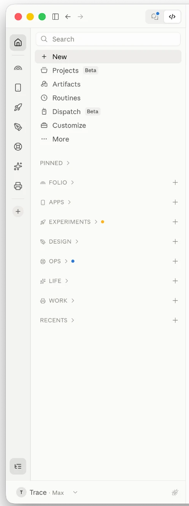
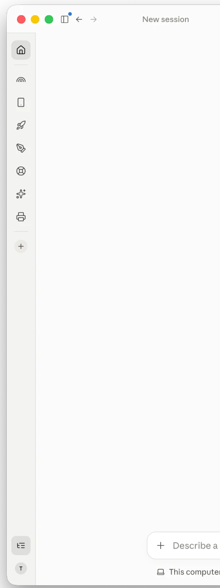
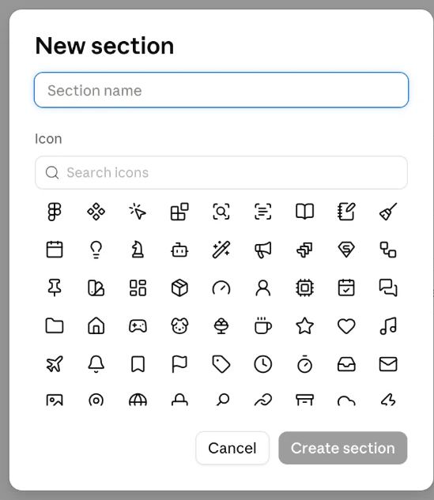

<div align="center">

<a href="https://github.com/traceorozco"></a>

# Claude Double Sidebar mod

**Your Claude sidebar, sorted into sections, with a rail to move between them.**

[](LICENSE)
[](#install)
[](https://github.com/traceorozco/claude-sidebar-icons)
[](#before-you-install)

Made by <a href="https://github.com/traceorozco">Trace Orozco</a>

</div>

<table>
<tr>
<td width="50%"></td>
<td width="50%"></td>
</tr>
<tr>
<td>The rail beside Claude's own sidebar.</td>
<td>Sidebar closed: the rail stays, with your account at its foot.</td>
</tr>
</table>

A double sidebar for the Claude desktop app on macOS, in Chat, Cowork and Code, drawn inside Claude's own sidebar:

- A rail down the sidebar's left edge with Home and one icon per section. Hover an icon for the section's name.
- Click a section and the sidebar shows only that section's sessions. Home shows everything.
- Right-click a section on the rail for New session, Change icon and Claude's own section options.
- The + at the foot of the rail makes a new section, with an icon picked in Claude's New section dialog.
- Icons on sections and sessions: rename one and pick from 245 line icons, with search.
- Subsections: name a session `research / woodblocks` and it sits under a RESEARCH heading in its section, shown without the prefix. A toggle on the rail switches between Show by subsection and Show all.
- Close Claude's sidebar and the rail stays, with your account at its foot.

<table>
<tr>
<td width="50%"></td>
<td width="50%"></td>
</tr>
<tr>
<td>Pick an icon for a section or session, with search.</td>
<td>Switch between Show by subsection and Show all.</td>
</tr>
</table>

<table>
<tr>
<td width="50%"></td>
<td width="50%"></td>
</tr>
<tr>
<td>The rail shows each section as an icon; hover one for its name. Home, above the divider, shows Claude's whole sidebar: every section plus Recents.</td>
<td>Your sections sit between the two dividers. The + below them makes a new section, with its icon, in Claude's own New section dialog.</td>
</tr>
</table>

<p align="center"></p>

<p align="center"><em>Making a section: name it and pick its icon in Claude's own dialog.</em></p>

## How it works

Claude's sidebar is part of the claude.ai page the app loads. The patch adds a small loader to Claude that runs the sidebar inside that page each time it loads, so it builds on Claude's real sidebar. The sidebar itself is a file outside the app, in `~/Library/Application Support/ClaudeDoubleSidebar/`, so updating it never touches Claude again.

Claude checks its files against a fingerprint in its signed settings, so the patch updates the fingerprint and signs Claude again with a certificate on your Mac called **Claude Local**, which the installer makes the first time. The same certificate every time keeps macOS's keychain and privacy permissions for Claude in place across installs. Claude is signed so that Anthropic's signature also satisfies it, which leaves Claude's own updater able to install Anthropic's updates.

The patch works on a copy of Claude.app beside it, signs and checks the copy, then swaps it in. If any step fails, Claude is left as it was. It checks first that Claude is laid out the way it expects, and stops before changing anything if not. It has been used on Claude 2.42304.2.

A Claude update replaces the patched app, so the sidebar goes until Claude is patched again. A small background agent does that: it notices the update, waits until you next quit Claude, patches it, and tells you in a notification. If the new Claude isn't laid out the way the mod expects, the agent leaves it alone and tells you the sidebar is off until the mod is updated. It deals with each Claude build once, so it never retries in a loop.

## Before you install

You install it at your own risk:

- Claude is signed by a certificate on your Mac instead of by Anthropic.
- A background agent stays installed to put the sidebar back after Claude updates. `./install.sh --no-agent` leaves it out.
- It's unofficial. A Claude update, or a change to the claude.ai page, can break the sidebar until the mod catches up. Modifying the app may not be allowed by Anthropic's terms.

`./install.sh --plan` lists every change it would make on your Mac, and changes nothing.

## Install

Needs macOS, [Node.js](https://nodejs.org) 18 or newer, and Apple's command line tools (`xcode-select --install`).

Install it from **Claude Code in Terminal**, not from the Claude desktop app. The install quits the desktop app while it patches it, so it has to run from outside it.

**With Claude Code.** Open Terminal, run `claude`, and paste:

```text
Install the Claude Double Sidebar mod from https://github.com/traceorozco/claude-double-sidebar-mod. Clone it to ~/code/claude-double-sidebar-mod, read AGENTS.md and follow it. Show me what it will change before installing, and only go ahead after I say yes.
```

Claude Code reads [AGENTS.md](AGENTS.md), shows you every change and asks before it starts. Claude quits, is patched and reopens with the sidebar.

**Or run it yourself** in Terminal:

```bash
git clone https://github.com/traceorozco/claude-double-sidebar-mod.git ~/code/claude-double-sidebar-mod
cd ~/code/claude-double-sidebar-mod
./install.sh
```

`./install.sh --yes` does the same without asking before it quits Claude.

Keep the folder you cloned it into: the background agent runs from there. If you move it, or change your Node.js version, run `./install.sh` again from the new place.

The first time, macOS may ask:

- for your login keychain password, so the installer can add the **Claude Local** certificate
- whether Claude can use **Claude Safe Storage**: choose **Always Allow**
- you to sign in to Claude again

## Updating

Pull the latest and run the installer again:

```bash
cd ~/code/claude-double-sidebar-mod
git pull
./install.sh
```

A sidebar update only replaces the sidebar file, so Claude stays open and macOS asks nothing. Quit and reopen Claude to load it.

After a Claude update, the background agent puts the sidebar back the next time you quit Claude. To have it back straight away, run `./install.sh`: it quits Claude, patches it and reopens it. The agent hasn't been through a real Claude update yet. If it can't patch, its notification says so, and `./install.sh` shows why.

## Uninstall

```bash
./uninstall.sh
```

This removes the background agent, puts back Claude's own files, signs Claude with your certificate and removes the sidebar file. It keeps the icon fonts, because section and session names with icons need them: add `--remove-fonts` to remove those too. Add `--yes` to skip the question before it quits Claude. For Claude exactly as Anthropic ships it, with its own signature, download it again from claude.ai/download.

## Working on the sidebar

The code is `src/sidebar.js`. `node build.mjs` builds it into the sidebar file Claude loads, and reopening Claude shows the change. `node patch.mjs --dev` installs a development build that also opens a debug port on 127.0.0.1:9339, for inspecting the page. Never leave a dev build installed day to day: run `node patch.mjs` to go back.

`node --test test/patch.test.mjs` tests the patcher against a copy of Claude in a temporary folder: installing, installing again, restoring, failures partway, the signing rules, the background agent after a simulated update, and a Claude it doesn't recognise. It never touches the Claude in /Applications or your own files. It signs with your **Claude Local** certificate, so install the mod once first.

## Licences

The mod is MIT licensed: see [LICENSE](LICENSE).

Icons from [Lucide](https://lucide.dev) (ISC) and [Tabler Icons](https://tabler.io/icons) (MIT), through [Claude sidebar icons](https://github.com/traceorozco/claude-sidebar-icons). See `vendor/claude-sidebar-icons/licenses/`.
