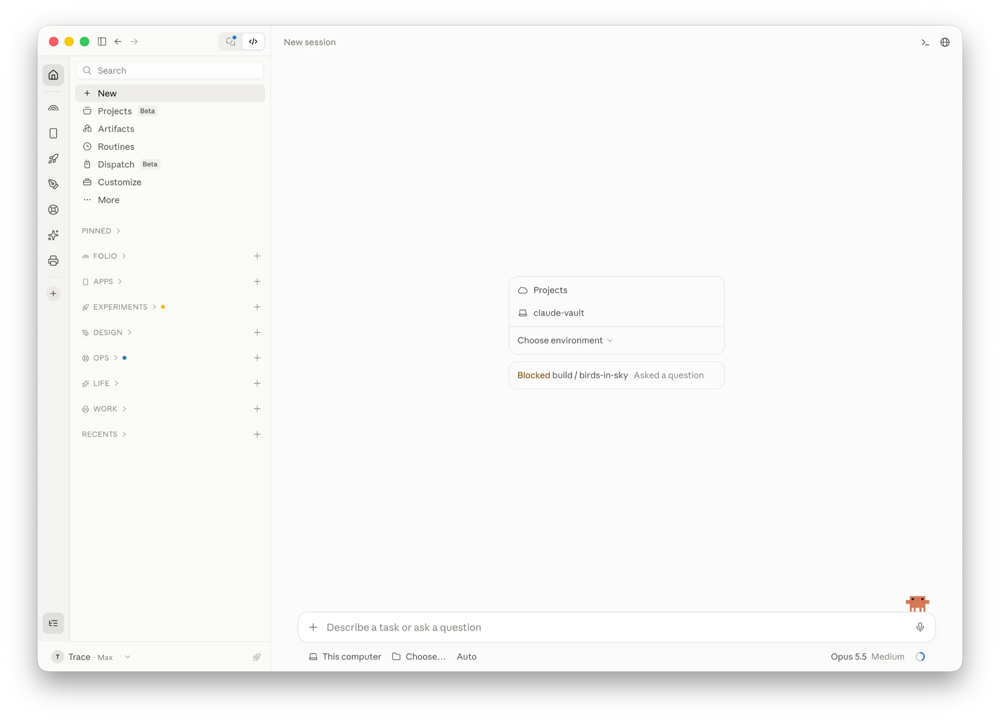
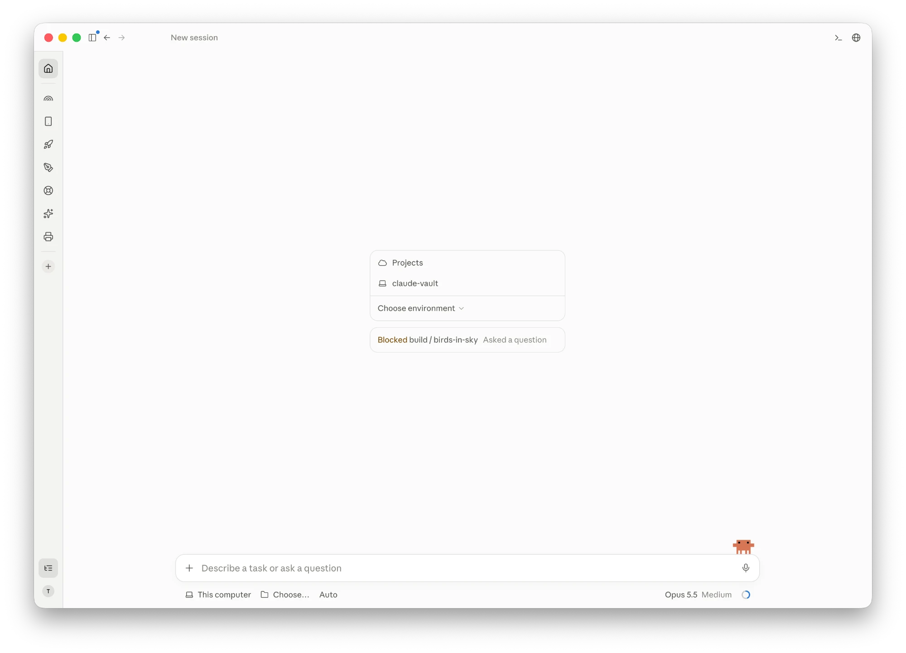
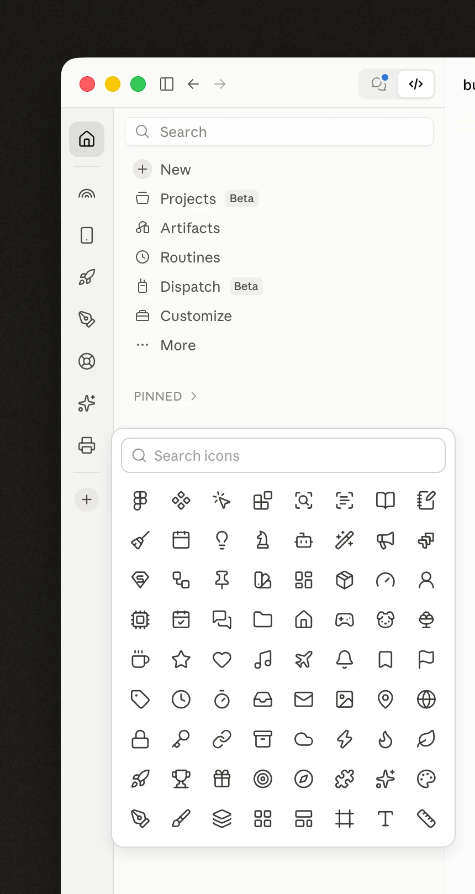
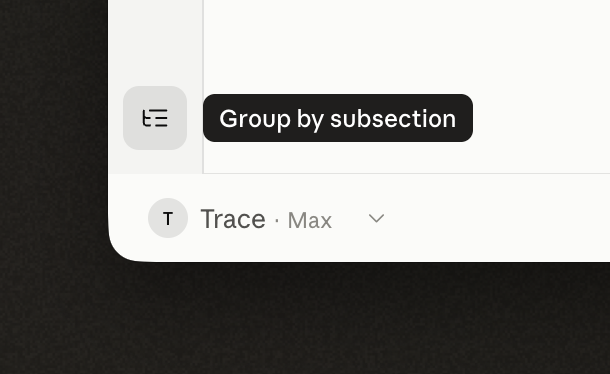
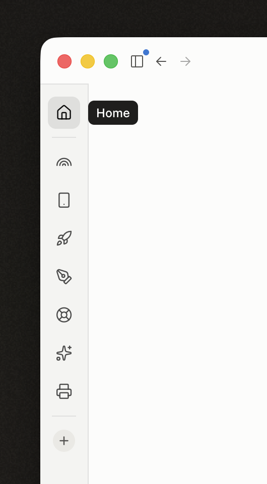
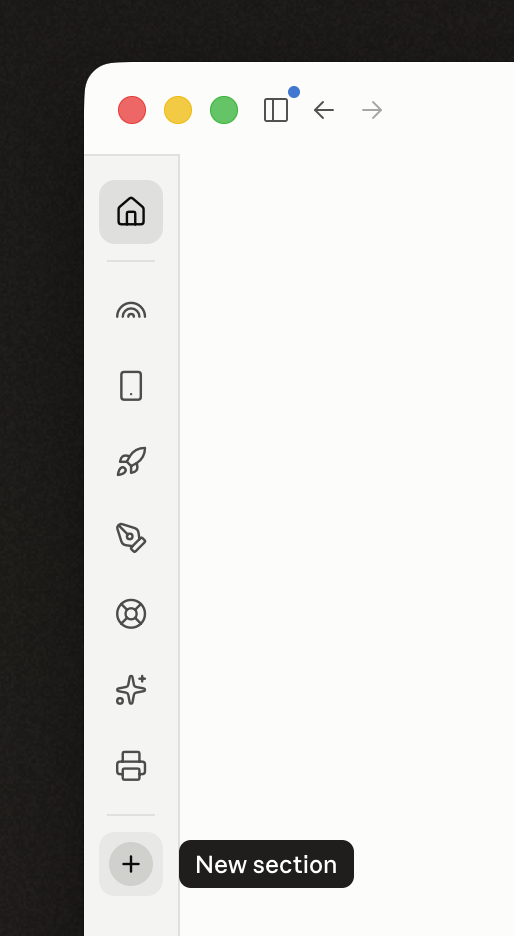

<div align="center">

<a href="https://github.com/traceorozco"></a>

# Claude Double Sidebar mod

**Your Claude sidebar, sorted into sections, with a rail to move between them.**

[](LICENSE)
[](#install)
[](https://github.com/traceorozco/claude-sidebar-icons)
[](#before-you-install)

Made by <a href="https://github.com/traceorozco">Trace Orozco</a>

</div>



A double sidebar for the Claude desktop app on macOS, in Chat, Cowork and Code, drawn inside Claude's own sidebar:

- A rail down the sidebar's left edge with Home and one icon per section. Hover an icon for the section's name.
- Click a section and the sidebar shows only that section's sessions. Home shows everything.
- Right-click a section on the rail for New session, Change icon and Claude's own section options.
- The + at the foot of the rail makes a new section, with an icon picked in Claude's New section dialog.
- Icons on sections and sessions: rename one and pick from 245 line icons, with search.
- Subsections: name a session `research / woodblocks` and it sits under a RESEARCH heading in its section, shown without the prefix. A toggle on the rail switches between Show by subsection and Show all.
- Close Claude's sidebar and the rail stays, with your account at its foot.

<table>
<tr>
<td width="50%"></td>
<td width="25%"></td>
<td width="25%"></td>
</tr>
<tr>
<td>Sidebar closed: the rail stays, with your account at its foot.</td>
<td>Pick an icon for a section or session, with search.</td>
<td>Turn subsection grouping on or off.</td>
</tr>
</table>

<table>
<tr>
<td width="50%"></td>
<td width="50%"></td>
</tr>
<tr>
<td>The rail shows each section as an icon; hover one for its name. Home, above the divider, shows Claude's whole sidebar: every section plus Recents.</td>
<td>Your sections sit between the two dividers. The + below them makes a new section, with its icon, in Claude's own New section dialog.</td>
</tr>
</table>

The icons are part of the names themselves, a character drawn by the [Claude sidebar icons](https://github.com/traceorozco/claude-sidebar-icons) font, so Claude shows them everywhere it shows a name.

## How it works

Claude's sidebar is part of the claude.ai page the app loads. The patch adds a small loader to Claude that runs the sidebar inside that page each time it loads, so it builds on Claude's real sidebar. The sidebar itself is a file outside the app, in `~/Library/Application Support/ClaudeDoubleSidebar/`, so updating it never touches Claude again. Nothing sits on top of Claude: dialogs, menus and Settings work as they always do.

That means changing Claude.app itself. Claude checks its files against a fingerprint in its signed settings, so the patch updates the fingerprint and signs Claude again with a certificate on your Mac called **Claude Local**, which the installer makes the first time. The same certificate every time keeps macOS's keychain and privacy permissions for Claude in place across installs.

What you give up:

- Claude's automatic updates stop working. To update, download Claude again from claude.ai/download, then run the installer again.
- Claude is no longer signed by Anthropic on your Mac. It's signed by your own certificate instead.

## Before you install

This modifies Claude for Desktop itself, and you install it at your own risk:

- Claude is signed by a certificate on your Mac instead of by Anthropic.
- Claude's automatic updates stop. Download Claude again to update, then rerun the installer.
- It's unofficial. A Claude update, or a change to the claude.ai page, can break the sidebar until the mod catches up. Modifying the app may not be allowed by Anthropic's terms.

`./install.sh --plan` lists every change it would make on your Mac, and changes nothing. If an AI is installing it for you, it should read [AGENTS.md](AGENTS.md) first.

## Install

Needs macOS, [Node.js](https://nodejs.org) 18 or newer, and Apple's command line tools (`xcode-select --install`).

Run it from Terminal, not from inside Claude, because it quits Claude while it patches:

```bash
git clone https://github.com/traceorozco/claude-double-sidebar-mod.git
cd claude-double-sidebar-mod
./install.sh
```

`./install.sh --yes` does the same without asking before it quits Claude.

The first time, macOS may ask:

- for your login keychain password, so the installer can add the **Claude Local** certificate
- whether Claude can use **Claude Safe Storage**: choose **Always Allow**
- you to sign in to Claude again

## Updating

Pull the latest and run the installer again:

```bash
cd claude-double-sidebar-mod
git pull
./install.sh
```

A sidebar update only replaces the sidebar file, so Claude stays open and macOS asks nothing. Quit and reopen Claude to load it.

After a Claude update, the new Claude has no loader, so the sidebar disappears. The same commands patch it again: the installer quits Claude, patches and signs it, and reopens it. macOS asks once more about **Claude Safe Storage**.

## Uninstall

```bash
./uninstall.sh
```

This puts back Claude's own files, signs Claude with your certificate and removes the sidebar file. It keeps the icon fonts, because section and session names with icons need them: add `--remove-fonts` to remove those too. Add `--yes` to skip the question before it quits Claude. For Claude exactly as Anthropic ships it, with its own signature and updates, download it again from claude.ai/download.

## Working on the sidebar

The code is `src/sidebar.js`. `node build.mjs` builds it into the sidebar file Claude loads, and reopening Claude shows the change. `node patch.mjs --dev` installs a development build that also opens a debug port on 127.0.0.1:9339, for inspecting the page. Never leave a dev build installed day to day: run `node patch.mjs` to go back.

## Licences

The mod is MIT licensed: see [LICENSE](LICENSE).

Icons from [Lucide](https://lucide.dev) (ISC) and [Tabler Icons](https://tabler.io/icons) (MIT), through [Claude sidebar icons](https://github.com/traceorozco/claude-sidebar-icons). See `vendor/claude-sidebar-icons/licenses/`.
